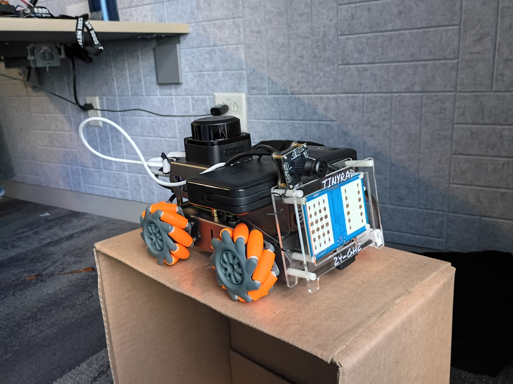
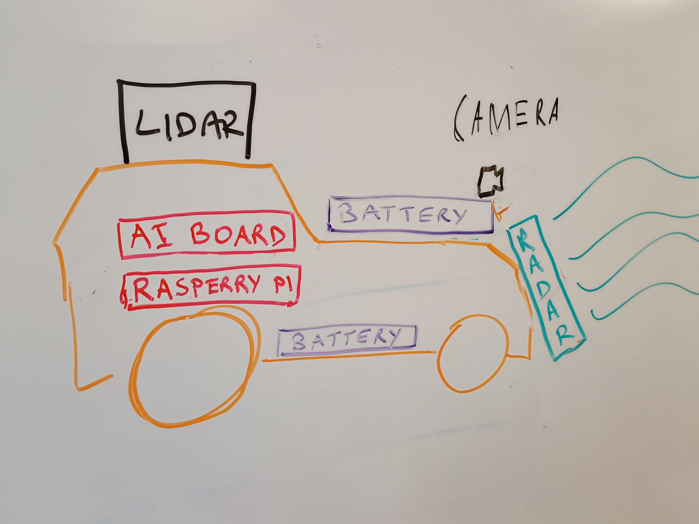

# WaveSense

Team 28 · Sal, Oleh, Kristjan
Code Metal Forge 2026 · Operation Lost and Found

WaveSense is a phone-driven search-and-rescue scout. A responder stays outside. The vehicle goes in first and sends back a camera picture, a local 2D lidar map, and a 24 GHz radar cue. A cue is something a person checks. It is not an identification, and no cue does not mean the space is empty.

The chassis is a Hiwonder MasterPi with mecanum wheels and a Raspberry Pi 5. On it: a USB camera, a Slamtec RPLIDAR C1, and an Analog Devices TinyRad on the nose. The phone drives the wheels, and the motors stay off until a stick moves.

The whiteboard sketch is the layout: lidar on top, camera, radar on the nose, Raspberry Pi, and batteries.

## Photos

All of the project photos are in [photos](photos/).

## Presentation

The ten-slide deck is [presentation/index.html](presentation/index.html). Open that file in a browser. Arrow keys move between slides.
